# Incident Manager

Application web de gestion des incidents informatiques et de cybersécurité, sécurisée avec **Spring Boot**, **Spring Security**, **JWT** et **React**.

Les employés déclarent des incidents, l'administrateur les affecte à des techniciens, et les techniciens les traitent jusqu'à leur clôture. Chaque action est tracée dans un historique, et chaque règle d'accès est vérifiée côté serveur.

---

## Sommaire

- [Technologies](#technologies)
- [Architecture](#architecture)
- [Prérequis](#prérequis)
- [Lancer le backend](#lancer-le-backend)
- [Lancer le frontend React](#lancer-le-frontend-react)
- [Ports utilisés](#ports-utilisés)
- [Comptes de test](#comptes-de-test)
- [Rôles disponibles](#rôles-disponibles)
- [Principaux endpoints](#principaux-endpoints)
- [Fonctionnalités réalisées](#fonctionnalités-réalisées)
- [Sécurité](#sécurité)
- [Modèle de données](#modèle-de-données)
- [Captures d'écran](#captures-décran)

---

## Technologies

| Couche | Technologies |
|---|---|
| Backend | Java 21, Spring Boot 4, Spring Security 7, Spring Data JPA (Hibernate 7), Bean Validation, Lombok |
| Authentification | JWT (jjwt 0.12), BCrypt, Refresh Token avec rotation |
| Base de données | H2 en mémoire (développement), MySQL supporté |
| Frontend | React, Vite, React Router, Axios, CSS natif |
| Tests API | Postman |

---

## Architecture

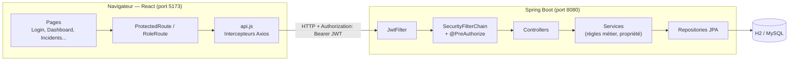

**Parcours d'une requête :**

1. L'intercepteur Axios ajoute `Authorization: Bearer <JWT>` à chaque requête.
2. `JwtFilter` vérifie la signature et l'expiration du token, recharge l'utilisateur depuis la base, puis place son identité dans le `SecurityContext`.
3. Spring Security applique les règles d'URL et les annotations `@PreAuthorize` (contrôle par **rôle**).
4. Les services vérifient la **propriété** des données (un employé ne voit que ses incidents, un technicien n'agit que sur ses incidents affectés).
5. En cas de `401`, l'intercepteur appelle `/auth/refresh`, puis rejoue la requête, si le refresh échoue, l'utilisateur est redirigé vers la page de connexion.

---

## Prérequis

- **JDK 21**
- **Node.js 22** ou plus récent
- **Git**
- **Postman** pour rejouer les tests

---

## Lancer le backend

```bash
cd backend
```

**1. Créer le fichier `.env`** à partir de l'exemple :

```bash
cp .env.example .env
```

Puis renseigner un secret JWT d'au moins 256 bits, encodé en Base64 :

```bash
openssl rand -base64 64
```

```properties
JWT_SECRET=<votre-secret-base64>
JWT_ACCESS_EXPIRATION_MS=300000
JWT_REFRESH_EXPIRATION_MS=86400000
```

> Le fichier `.env` n'est jamais versionné. L'application refuse de démarrer si `JWT_SECRET` est absent ou trop court.

**2. Démarrer l'application :**

```bash
# Linux / macOS
./mvnw spring-boot:run

# Windows
mvnw.cmd spring-boot:run
```

Depuis IntelliJ IDEA : lancer `BackendApplication`, en vérifiant que le **Working directory** de la configuration d'exécution pointe sur le dossier `backend` (sinon le fichier `.env` n'est pas trouvé).

**3. Console H2 (optionnel) :** `http://localhost:8080/h2-console`

| Champ | Valeur |
|---|---|
| JDBC URL | `jdbc:h2:mem:incidentsdb` |
| User | `sa` |
| Password | *(vide)* |

> La base H2 est en mémoire : elle est vidée à chaque redémarrage. Les comptes de test sont recréés automatiquement au démarrage par `DataSeeder`.

---

## Lancer le frontend React

```bash
cd frontend
cp .env.example .env
npm install
npm run dev
```

Contenu du `.env` :

```properties
VITE_API_URL=http://localhost:8080
```

L'application est ensuite disponible sur **http://localhost:5173**.

> Le backend doit être démarré avant le frontend. Le port 5173 est imposé (`strictPort`) car c'est la seule origine autorisée par la configuration CORS du backend.

---

## Ports utilisés

| Service | Port | URL |
|---|---|---|
| Backend Spring Boot | `8080` | http://localhost:8080 |
| Frontend React (Vite) | `5173` | http://localhost:5173 |
| Console H2 | `8080` | http://localhost:8080/h2-console |

---

## Comptes de test

Créés automatiquement au démarrage par `DataSeeder` :

| Rôle | Nom | Email | Mot de passe | État |
|---|---|---|---|---|
| ADMIN | Administrateur | `admin@incidents.ma` | `Admin@123` | Actif |
| TECHNICIAN | Technicien A | `tech1@incidents.ma` | `Tech@1234` | Actif |
| TECHNICIAN | Technicien B | `tech2@incidents.ma` | `Tech@1234` | Actif |
| EMPLOYEE | Ahmed Benali | `employee1@incidents.ma` | `Employee@123` | Actif |
| EMPLOYEE | Sara Alaoui | `employee2@incidents.ma` | `Employee@123` | Actif |
| EMPLOYEE | Compte Désactivé | `disabled@incidents.ma` | `Disabled@123` | **Désactivé** |

Le compte désactivé permet de tester le refus de connexion d'un utilisateur désactivé.

---

## Rôles disponibles

| Rôle | Droits |
|---|---|
| **EMPLOYEE** | Créer un compte, déclarer des incidents, consulter **uniquement ses** incidents et leur historique, gérer son profil |
| **TECHNICIAN** | Consulter les incidents **qui lui sont affectés**, modifier leur statut, ajouter des notes de traitement |
| **ADMIN** | Consulter tous les incidents, affecter un technicien, modifier les statuts, clôturer, gérer les utilisateurs (activer / désactiver), consulter les statistiques |

L'inscription publique (`/auth/register`) crée **toujours** un compte `EMPLOYEE` : le rôle n'est jamais accepté depuis la requête.

---

## Principaux endpoints

### Authentification — public

| Méthode | URL | Description |
|---|---|---|
| POST | `/auth/register` | Inscription (rôle EMPLOYEE imposé) |
| POST | `/auth/login` | Connexion, retourne `token`, `refreshToken`, `role`, `fullName` |
| POST | `/auth/refresh` | Nouveau couple de tokens à partir d'un refresh token |
| POST | `/auth/logout` | Révocation du refresh token |

### Profil — tout utilisateur authentifié

| Méthode | URL | Description |
|---|---|---|
| GET | `/api/profile` | Consulter son profil |
| PUT | `/api/profile` | Modifier son nom et son email (retourne un nouveau token) |
| PUT | `/api/profile/password` | Changer son mot de passe (ancien mot de passe vérifié) |

### Incidents

| Méthode | URL | Accès |
|---|---|---|
| POST | `/api/incidents` | EMPLOYEE |
| GET | `/api/incidents/my` | EMPLOYEE |
| GET | `/api/incidents/assigned` | TECHNICIAN |
| GET | `/api/incidents` | ADMIN |
| GET | `/api/incidents/{id}` | Propriétaire, technicien affecté ou ADMIN |
| PUT | `/api/incidents/{id}/assign/{technicianId}` | ADMIN |
| PUT | `/api/incidents/{id}/status` | TECHNICIAN affecté ou ADMIN |
| POST | `/api/incidents/{id}/comments` | TECHNICIAN affecté ou ADMIN |

### Administration — ADMIN

| Méthode | URL | Description |
|---|---|---|
| GET | `/api/admin/users` | Liste des utilisateurs |
| GET | `/api/admin/technicians` | Techniciens actifs (liste d'affectation) |
| PUT | `/api/admin/users/{id}/enable` | Activer un compte |
| PUT | `/api/admin/users/{id}/disable` | Désactiver un compte |
| GET | `/api/admin/statistics` | Statistiques globales |

### Tableaux de bord

| Méthode | URL | Accès |
|---|---|---|
| GET | `/api/dashboard/employee` | EMPLOYEE |
| GET | `/api/dashboard/technician` | TECHNICIAN |

---

## Fonctionnalités réalisées

### Authentification et sécurité
- Inscription et connexion avec JWT signé (HMAC-SHA512) contenant `sub` (email), `role`, `iat` et `exp`
- Mots de passe hachés avec **BCrypt**
- API **stateless**, CSRF désactivé, CORS limité à `http://localhost:5173`
- Réponses JSON personnalisées pour `401` (`AuthenticationEntryPoint`) et `403` (`AccessDeniedHandler`)
- Gestion centralisée des erreurs avec `@RestControllerAdvice`
- Validation des entrées avec `@Valid` (`@NotBlank`, `@Email`, `@Size`, `@NotNull`)
- Contrôle d'accès à deux niveaux : **rôle** (règles d'URL + `@PreAuthorize`) et **propriété** des données (services)
- Désactivation d'un compte **effective immédiatement**, même avec un JWT encore valide
- **Refresh Token** : stocké haché (SHA-256) en base, à usage unique (**rotation**), avec **détection de réutilisation** (révocation de toutes les sessions de l'utilisateur)
- Déconnexion avec révocation du refresh token ; changement de mot de passe révoquant toutes les sessions

### Gestion des incidents
- Déclaration d'incidents (titre, description, catégorie, priorité)
- Cycle de vie contrôlé par une machine à états :

```
OPEN ──(affectation)──► ASSIGNED ──► IN_PROGRESS ──► RESOLVED ──► CLOSED
                                         ▲               │
                                         └───────────────┘
```

- Un incident `CLOSED` ne peut plus être modifié, réaffecté ni commenté
- Affectation à un technicien actif uniquement
- **Historique** automatique de chaque action (création, affectation, changement de statut), avec auteur et date
- **Notes de traitement** des techniciens

### Interface React
- Pages : Login, Register, Dashboard, Profil, Mes incidents, Nouvel incident, Détail d'un incident, Incidents affectés, Tous les incidents (avec filtres), Utilisateurs
- Routes protégées (`ProtectedRoute`) et par rôle (`RoleRoute`), menu adapté au rôle
- Intercepteurs Axios : ajout automatique du JWT, renouvellement transparent du token, déconnexion et redirection si la session ne peut pas être renouvelée
- Tableaux de bord spécifiques à chaque rôle (compteurs, derniers incidents, répartition par statut)
- Panneau d'actions sur l'incident (statut, affectation, notes) selon le rôle
- Gestion du profil et changement de mot de passe

### Administration
- Liste des utilisateurs, activation et désactivation des comptes
- Un administrateur ne peut pas désactiver son propre compte
- Statistiques globales sur les utilisateurs et les incidents

---

## Sécurité

Les protections côté React (routes, menus, boutons) servent uniquement le **confort d'utilisation**. Toutes les règles sont appliquées par le backend :

| Règle | Où elle est appliquée |
|---|---|
| Rôle imposé à l'inscription | DTO `RegisterRequest` sans champ `role` |
| Accès par rôle | `SecurityConfig` (URL) + `@PreAuthorize` |
| Un employé ne voit que ses incidents | `IncidentService.checkCanView` |
| Un technicien n'agit que sur ses incidents | `IncidentService.checkCanModify` |
| Compte désactivé refusé | `CustomUserDetailsService` + `JwtFilter` |
| Incident clôturé non modifiable | `IncidentService` |

Exemple : modifier le rôle stocké dans le `localStorage` en `ADMIN` affiche le menu administrateur, mais chaque appel à l'API d'administration renvoie `403`, car le backend vérifie le rôle réel de l'utilisateur.

---

## Modèle de données

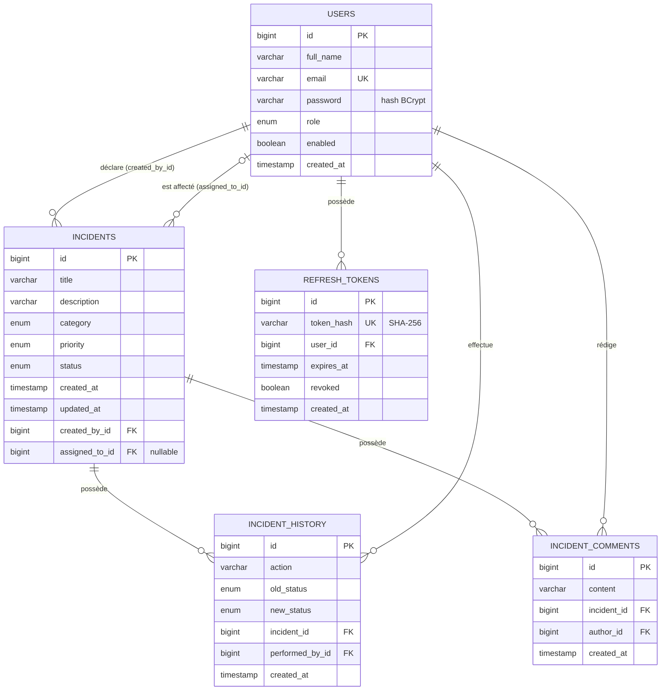

Toutes les relations sont des `@ManyToOne` unidirectionnelles en chargement **LAZY**. Les requêtes qui ont besoin des relations les chargent explicitement avec `@EntityGraph`, ce qui évite le problème N+1.

---

## Captures d'écran

### Application

| | |
|---|---|
| 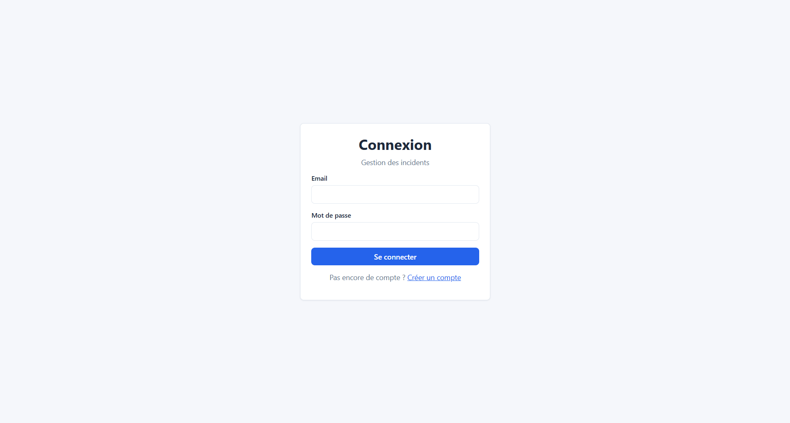 | 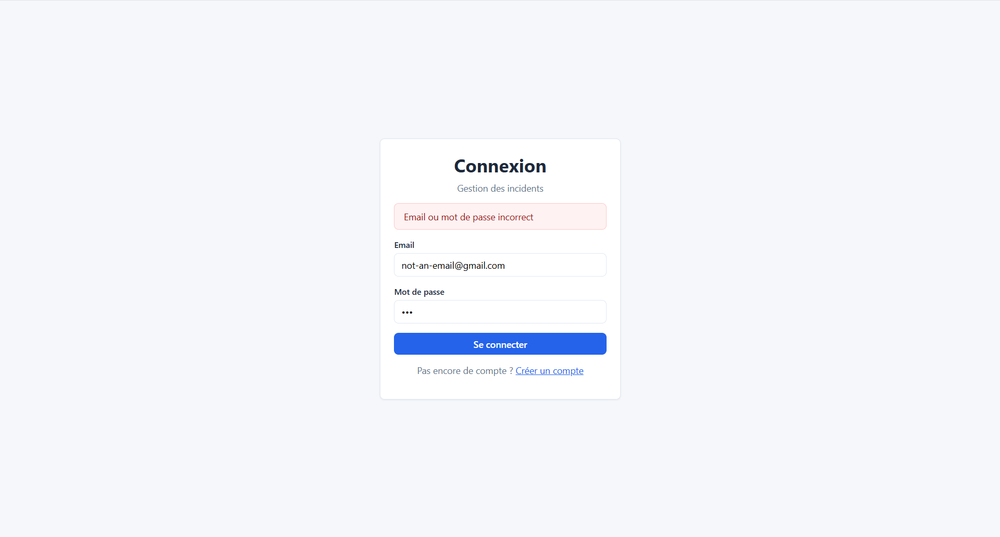 |
| Connexion | Validation du formulaire d'inscription |
| 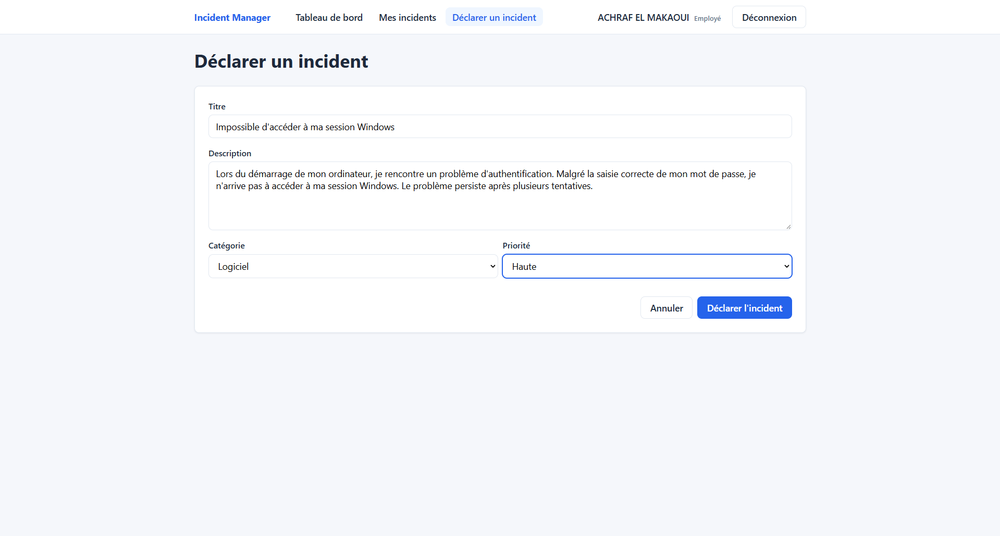 | 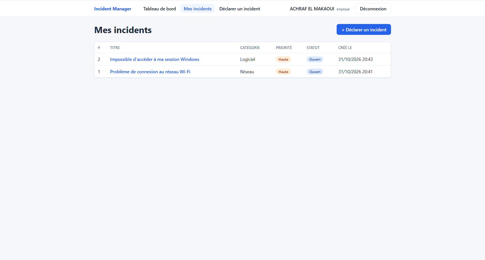 |
| Déclaration d'un incident | Mes incidents |
| 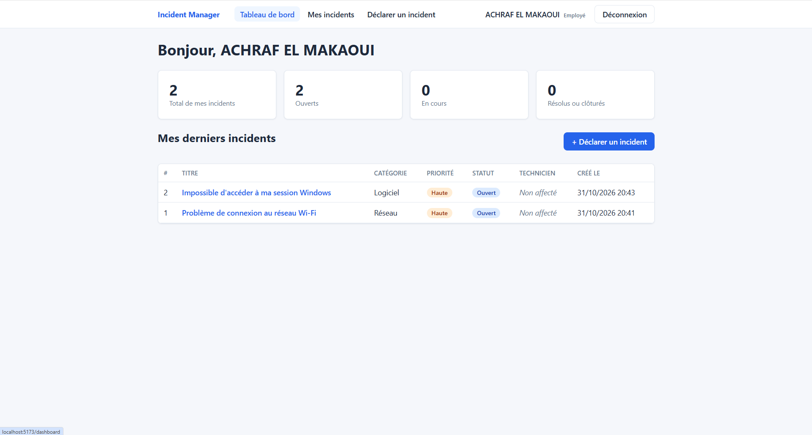 | 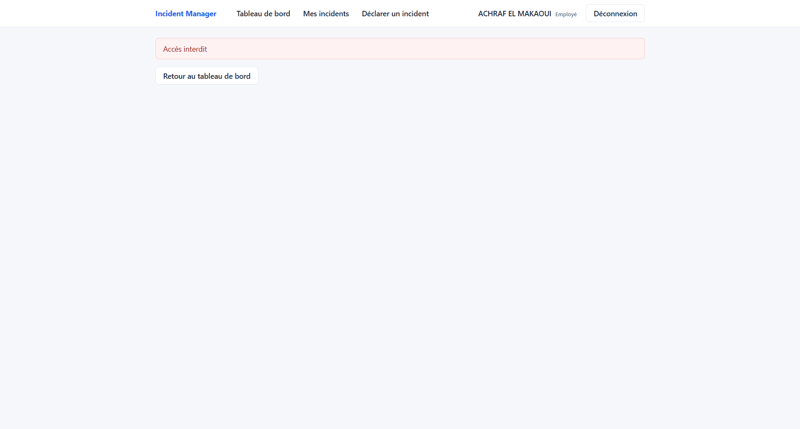 |
| Tableau de bord employé | Accès à l'incident d'un autre employé refusé |
| 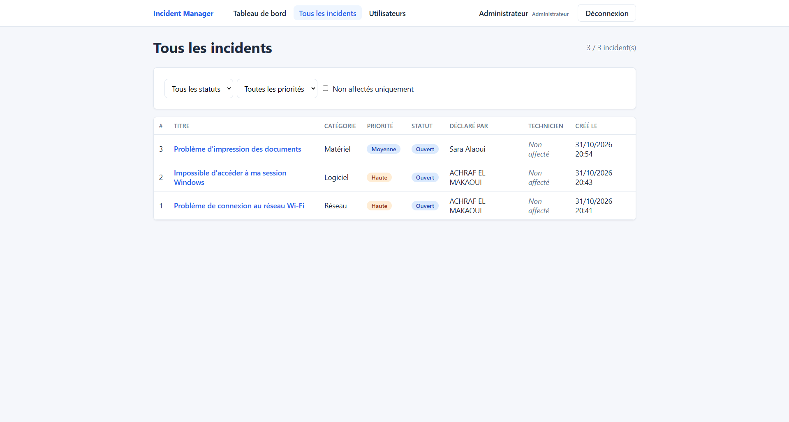 | 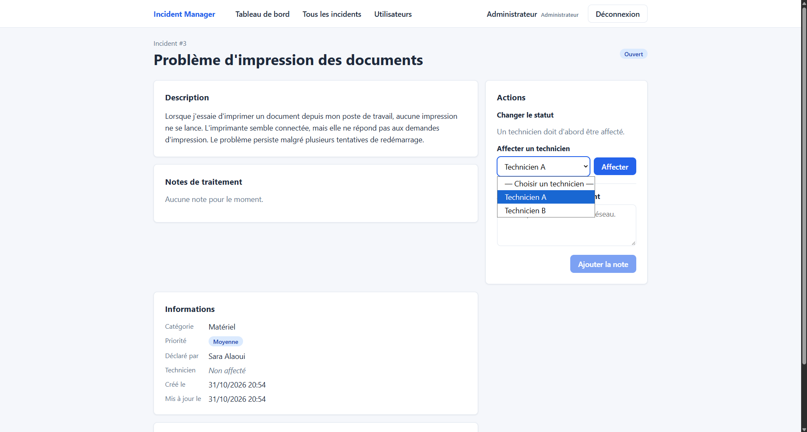 |
| Tous les incidents (ADMIN) | Affectation d'un technicien |
| 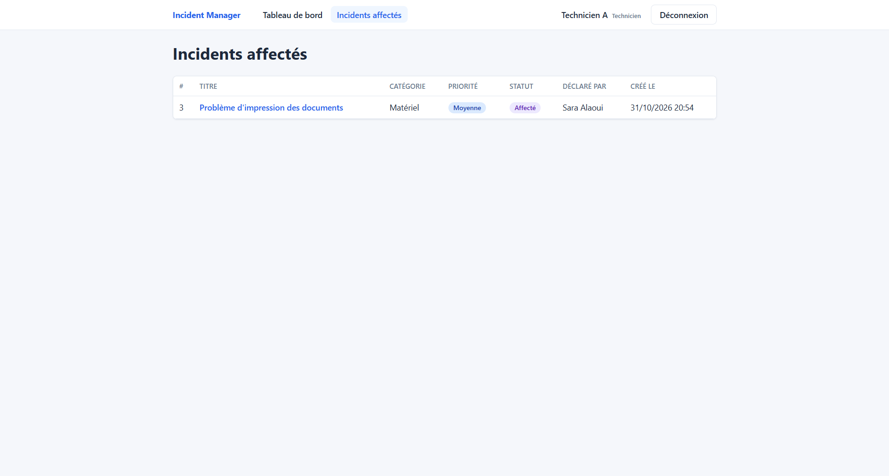 | 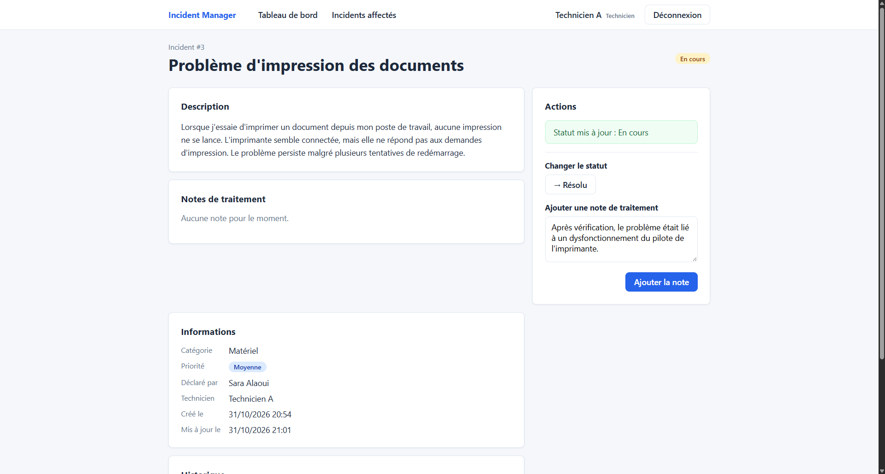 |
| Incidents affectés (TECHNICIAN) | Changement de statut et note de traitement |
| 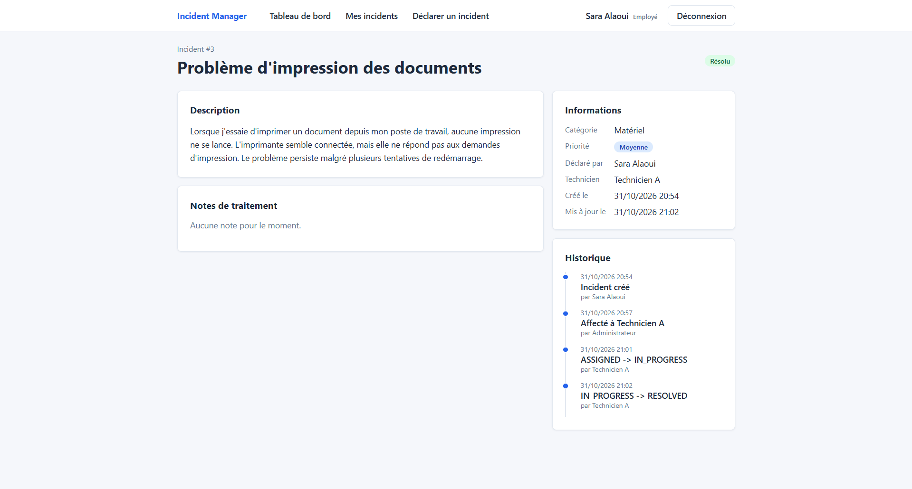 | 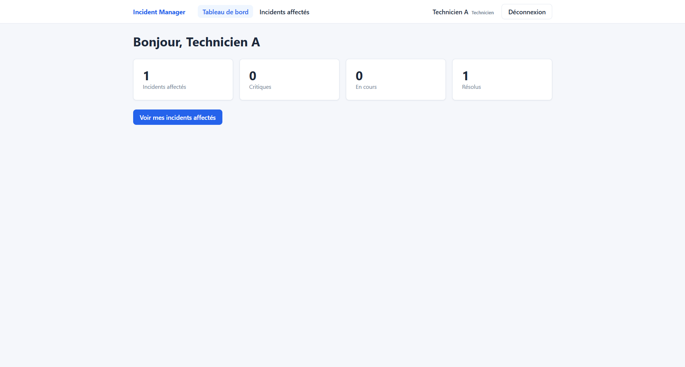 |
| État final et historique vus par l'employé | Tableau de bord technicien |
| 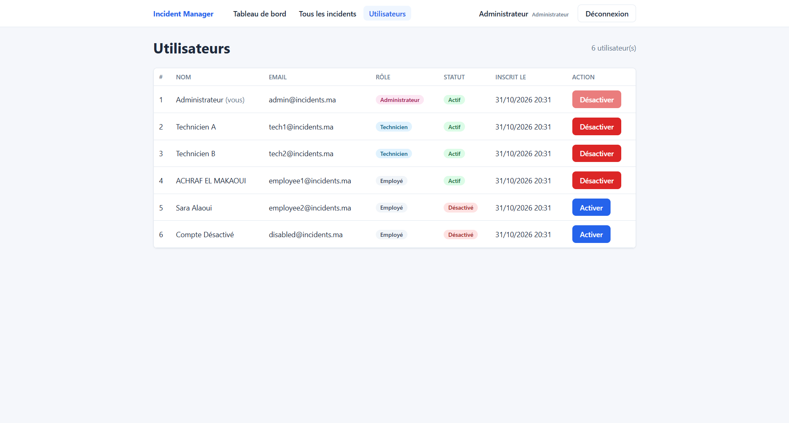 | 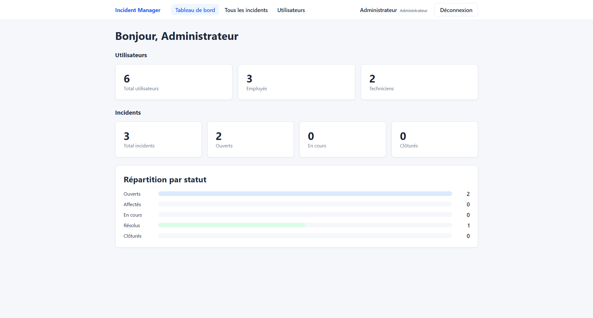 |
| Gestion des utilisateurs | Tableau de bord administrateur |

### Tokens et sécurité

| | |
|---|---|
| 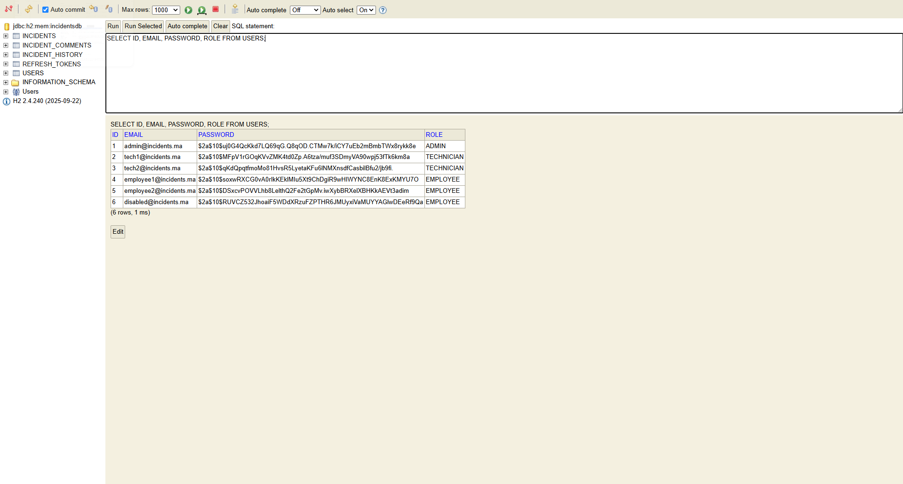 | 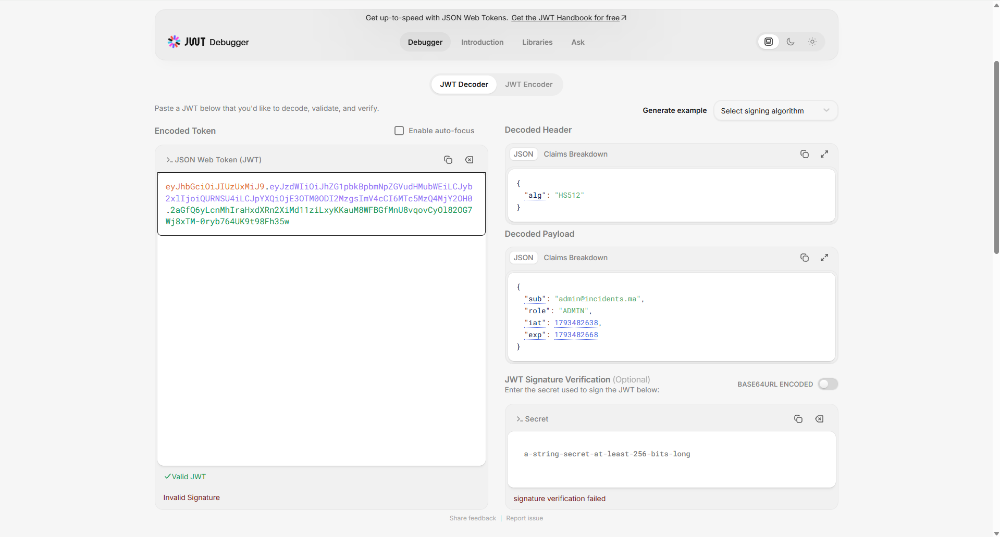 |
| Mots de passe hachés avec BCrypt | Contenu d'un JWT (claims) |


## Structure du projet

```
incident-manager/
├── backend/
│   └── src/main/java/com/elmakaoui/incidents/
│       ├── config/         SecurityConfig, DataSeeder
│       ├── security/       JwtService, JwtFilter, handlers 401/403
│       ├── entities/       User, Incident, IncidentHistory, IncidentComment, RefreshToken
│       ├── enums/          Role, Category, Priority, Status
│       ├── repositories/
│       ├── dtos/
│       ├── services/
│       ├── web/            Controllers REST
│       └── exceptions/     Exceptions métier + GlobalExceptionHandler
├── frontend/
│   └── src/
│       ├── components/     Navbar, ProtectedRoute, RoleRoute, IncidentTable, IncidentActions
│       ├── context/        AuthContext
│       ├── pages/
│       ├── services/       api.js, authService, incidentService, adminService...
│       └── utils/          Libellés et formatage des dates
└── docs/
    ├── screenshots/
    └── postman/
```
